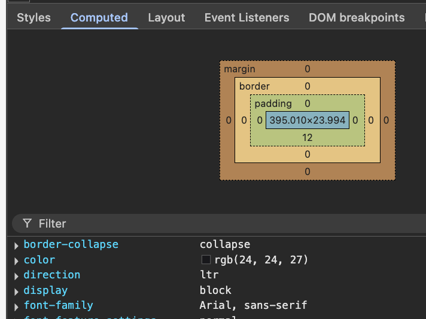

# 0103 · Materiały dla ucznia - „CSS3: stylowanie i responsywność"

Technologie webowe · ZST w Tarnowie × Akademia Tarnowska

Ten pakiet to wszystko, czego potrzebujesz na dzisiejszych zajęciach: ta instrukcja oraz przykładowy plik startowy [index.html](index.html) (semantyczny fanpage zespołu „Bity z Podwórka" z 0102, gotowy do ostylowania). Rozpiska prowadzącego, kartkówka i rozwiązania zostają u niego.

Dziś Twój **fanpage z 0102 nabiera wyglądu**: dostanie własną paletę kolorów, czcionki z Google Fonts, poziome menu i siatkę kart we **Flexboxie**, tabelę w paski oraz **wersję mobilną (RWD)**, która działa na telefonie. Na **0104** ożywimy tę stronę pierwszym skryptem w JavaScript.

## Plan spotkania - 3 bloki

| Blok | Czas | Co się dzieje |
|---|---|---|
| 1 | 7:30–8:15 | kartkówka nr 2 z 0102 (10 min) · 3 sposoby wpięcia CSS (`link` do `style.css`) · selektory, kaskada i specyficzność · **box model** i `box-sizing: border-box` |
| 2 | 8:15–9:00 | kolory (`#hex`, `rgb`/`rgba`, `hsl`, zmienne CSS) i jednostki (`px`, `rem`, `%`, `vh`/`vw`) · typografia i Google Fonts · *przerwa 15 min* · **Flexbox**: nawigacja, karty obok siebie i tabela w paski |
| 3 | 9:00–9:45 | **responsywność (RWD)**: `meta viewport`, `@media`, mobile-first · **a11y w CSS**: kontrast WCAG i `:focus-visible` · **stylujesz swój fanpage** (warianty A/B/C) · podsumowanie i zapowiedź 0104 |

Pracujesz **samodzielnie** z tą instrukcją: najpierw poznajesz podstawowe zasady CSS poniżej, a potem stylujesz własny fanpage z 0102 w pliku `style.css`. Miej otwarte od początku zajęć: VS Code z Live Server i przeglądarkę Chrome.

## Jak o tym myśleć - 4 modele myślowe CSS

Zamiast wkuwać setki właściwości na pamięć, zapamiętaj cztery reguły gry, według których przeglądarka rysuje każdą stronę (pełną listę właściwości zawsze znajdziesz w [MDN Web Docs - CSS po polsku](https://developer.mozilla.org/pl/docs/Web/CSS)).

### 1. Kaskada i specyficzność: kto wygrywa, gdy reguły się kłócą?

Kiedy do jednego elementu pasują dwie reguły CSS, przeglądarka rozstrzyga spór w dwóch krokach:

1. **Najpierw patrzy na siłę (specyficzność) selektora:**
   `znacznik` (np. `p`, `section`) **<** `.klasa` / `:hover` / `[atrybut]` **<** `#id` **<** `style=""` (inline).
   Silniejszy selektor wygrywa **zawsze**, nawet jeśli leży na samej górze pliku.
2. **Przy remisie wygrywa reguła zapisana niżej w pliku** (stąd słowo *kaskada* - styl spływa z góry na dół).

Wniosek praktyczny: **do stylowania używaj głównie klas (`.card`, `.subtitle`) i znaczników semantycznych (`header`, `nav a`)**, a identyfikatory (`#id`) zostaw do zakotwiczeń z 0102 i wyjątków.

### 2. Box model: wszystko na stronie jest prostokątnym pudełkiem

Niezależnie od tego, czy widzisz okrągły przycisk, kartę zdjęcia czy akapit tekstu - dla przeglądarki to prostokątne pudełko złożone z 4 warstw (od środka na zewnątrz):

1. **`content`** - sama treść (tekst, obrazek),
2. **`padding`** - wewnętrzny „koc" wokół treści (**ma kolor tła pudełka!**),
3. **`border`** - ramka pudełka (`1px solid #334155`, zaokrąglana przez `border-radius`),
4. **`margin`** - zewnętrzny dystans od sąsiednich pudełek (**zawsze przezroczysty**).

Domyślnie przeglądarka liczy szerokość w starym trybie (`content-box`): jeśli dasz `width: 300px` i `padding: 20px`, pudełko urośnie do `340px` i rozwali układ. Dlatego **każdy plik `style.css` zaczynamy od zaklęcia**:

```css
*, *::before, *::after {
  box-sizing: border-box;
}
```

Od tej chwili `width: 300px` oznacza „całe pudełko razem z paddingiem i ramką ma 300px".

Wszystkie cztery warstwy danego elementu możesz podejrzeć w **Chrome DevTools** (`F12` → zakładka **Elements** → panel **Computed** po prawej):



### 3. Flexbox: rodzic rządzi układem dzieci

Chcesz ustawić pozycje menu obok siebie albo ułożyć trzy karty w rzędzie? Nie męcz pojedynczych elementów - **nadaj `display: flex` ich bezpośredniemu rodzicowi** (np. `nav ul` albo `.gallery`):

- rodzic staje się kontenerem flex i układa swoje dzieci wzdłuż **osi głównej** (`justify-content`) oraz **osi poprzecznej** (`align-items`),
- odstępy między dziećmi załatwia jedna właściwość na rodzicu: `gap: 1rem;`,
- dodaj `flex-wrap: wrap;`, żeby elementy grzecznie spadły do nowego wiersza, gdy ekran zrobi się za wąski.

### 4. Responsywność (RWD) i a11y w CSS: strona dla każdego ekranu i każdych oczu

- **Elastyczność przede wszystkim:** obrazki dostają `max-width: 100%; height: auto;`, a główny kontener strony `max-width: 64rem; margin: 0 auto;` (zamiast sztywnego `width: 1024px`).
- **Media queries (`@media`)** to przełącznik układu dla węższych lub szerszych ekranów (np. na telefonie zmieniasz `flex-direction: column`).
- **Kontrast i fokus to część dostępności (a11y):** piękna paleta nic nie daje, jeśli tekst zlewa się z tłem. Minimum według standardu **WCAG 2.2 AA** to **4.5 : 1** dla zwykłego tekstu (sprawdzisz to jednym kliknięciem w próbniku kolorów DevTools, w audycie Lighthouse albo w kalkulatorze [WebAIM Contrast Checker](https://webaim.org/resources/contrastchecker/)). I nigdy nie wyłączaj obwódki fokusu (`outline: none`) bez podania wyraźnego zamiennika w `:focus-visible`!

---

## Zanim zaczniesz ćwiczenie główne

1. Otwórz w VS Code swój katalog **`fanpage/`** z zajęć 0102.
   - *Zgubiłeś/aś projekt z 0102?* Skopiuj [index.html](index.html) z dzisiejszego pakietu do nowego katalogu `fanpage/` i podmień treść na własną.
2. W katalogu `fanpage/` (obok `index.html`) utwórz plik **`style.css`**.
3. W pliku `index.html` wewnątrz sekcji `<head>` podepnij arkusz stylów:
   ```html
   <link rel="stylesheet" href="style.css">
   ```
4. Sprawdź w `<section id="galeria">`, czy Twoje karty `<figure>` (lub obrazki ``) mają wspólnego rodzica `<div class="gallery">...</div>` - dzięki temu jednym `display: flex` ustawisz je obok siebie.

---

## Ściąga 1: Selektory CSS i ich waga

| Zapis w CSS | Co wybiera | Przykład w HTML | Waga (specyficzność) |
|---|---|---|---|
| `section`, `p`, `th` | wszystkie znaczniki danego typu | `<section>...</section>` | niska (`0-0-1`) |
| `.card`, `.subtitle` | elementy z daną klasą (wielokrotnego użytku) | `<p class="subtitle">` | średnia (`0-1-0`) |
| `[required]` | elementy z danym atrybutem | `<input required>` | średnia (`0-1-0`) |
| `a:hover`, `tr:nth-child(even)` | element w określonym stanie / pozycji (pseudoklasa) | najechanie myszą / parzysty wiersz | średnia (`0-1-0`) |
| `#zapis`, `#galeria` | jeden unikalny element o tym `id` | `<section id="zapis">` | wysoka (`1-0-0`) |
| `nav a` *(spacja)* | każde `<a>` wewnątrz `<nav>` (potomek) | `<nav><ul><li><a>` | suma składowych |
| `h1, h2, h3` *(przecinek)* | wspólna reguła dla kilku selektorów naraz | `<h1>`, `<h2>`, `<h3>` | liczona osobno |

> Chcesz przećwiczyć selektory w praktyce? Zagraj w [CSS Diner](https://flukeout.github.io/).

### Kategorie selektorów i właściwości (stylów) CSS

Żeby łatwo odnaleźć się w dokumentacji (np. MDN) i w narzędziach DevTools, cały CSS warto dzielić na dwie mapy:

**1. Kategorie selektorów** *(kogo stylujemy?)*:

| Kategoria | Przykłady | Do czego służy |
|---|---|---|
| **Podstawowe** | `p`, `.card`, `#zapis`, `*` | wybór po znaczniku, klasie, `id` lub wszystkich naraz |
| **Kombinatory (relacje)** | `nav a`, `ul > li`, `h2 + p` | wybór po położeniu w HTML (potomek, bezpośrednie dziecko, sąsiad) |
| **Atrybutów** | `[required]`, `input[type="email"]` | wybór po obecności lub wartości atrybutu HTML |
| **Pseudoklasy** | `:hover`, `:focus-visible`, `:nth-child(even)` | wybór po stanie elementu (np. najechanie, fokus) lub pozycji |
| **Pseudoelementy** | `::before`, `::after`, `::first-line` | stylowanie fragmentu elementu lub wstawianie treści z CSS |

**2. Kategorie właściwości / stylów** *(co zmieniamy?)*:

| Kategoria | Przykładowe właściwości |
|---|---|
| **Layout (układ strony)** | `display` (`block`, `flex`, `grid`), `flex-direction`, `justify-content`, `align-items`, `gap`, `position` |
| **Box model i wymiary** | `box-sizing`, `width`, `max-width`, `height`, `padding`, `margin`, `border`, `border-radius` |
| **Typografia** | `font-family`, `font-size`, `font-weight`, `line-height`, `text-align`, `text-decoration` |
| **Kolory i tła** | `color`, `background-color`, `background-image`, `opacity` |
| **Efekty i animacje** | `box-shadow`, `transition`, `transform`, `@keyframes` *(0104)* |
| **Responsywność i a11y** | `@media (...)`, `outline`, `outline-offset` |

## Ściąga 1b: Nazwy klas i zmiennych - po angielsku

Właściwości CSS są po angielsku, więc nazwy klas i zmiennych też piszemy po angielsku - tak jak w Bootstrapie, Tailwindzie i w pracy. Komentarze i treść strony zostają po polsku. Na INF.03 piszesz nazwy dokładnie takie, jakie podaje arkusz.

| Nazwa | Znaczenie |
|---|---|
| `.gallery` | galeria (kontener kart) |
| `.card` | karta |
| `.subtitle` | podtytuł |
| `.consent-row` | wiersz ze zgodą (checkbox + label) |
| `--color-bg` / `--color-text` | kolor tła / tekstu |
| `--color-card` / `--color-border` | tło karty / kolor ramki |
| `--color-muted` | przygaszony kolor opisów |
| `--color-accent` / `--color-secondary` | kolor akcentu / drugi kolor wyróżnień |

## Ściąga 2: Jednostki w CSS - które do czego?

| Jednostka | Znaczenie | Do czego używać w projekcie |
|---|---|---|
| **`rem`** | wielokrotność rozmiaru czcionki z `<html>` (`1rem` = zwykle `16px`) | **fonty (`font-size`), odstępy (`padding`, `margin`, `gap`), `max-width` kontenera** |
| **`px`** | stały piksel ekranowy | cienkie obramowania (`border: 1px solid`), cienie, progi `@media (max-width: 640px)` |
| **`%`** | procent wymiaru rodzica | szerokości obrazków i tabel (`width: 100%`, `max-width: 100%`) |
| **`em`** | wielokrotność czcionki rodzica / bieżącego elementu | wewnętrzny padding przycisku proporcjonalny do jego tekstu |
| **`vh` / `vw`** | 1% wysokości / szerokości okna przeglądarki | pełnoekranowe sekcje powitalne (`min-height: 100vh`) |

## Ściąga 3: Flexbox w 6 linijkach

Wpisujesz na **rodzicu** (kontenerze), układają się **bezpośrednie dzieci**:

```css
.kontener {
  display: flex;                /* włącz Flexbox */
  flex-direction: row;          /* kierunek: row (poziomo) lub column (pionowo) */
  justify-content: space-between; /* oś główna: flex-start | center | space-between | space-around */
  align-items: center;          /* oś poprzeczna: stretch | center | flex-start */
  flex-wrap: wrap;              /* zawijaj do kolejnego wiersza, gdy brakuje miejsca */
  gap: 1rem;                    /* równy odstęp między dziećmi */
}
```

> Do treningu: gra [Flexbox Froggy (po polsku)](https://flexboxfroggy.com/#pl) oraz wizualna ściąga [CSS-Tricks: A Complete Guide to Flexbox](https://css-tricks.com/snippets/css/a-guide-to-flexbox/).

## Ściąga 4: Cheatsheet właściwości CSS (wg kategorii)

> Pełniejszą, angielską ściągę w podobnym podziale znajdziesz też na [Coddy - CSS Cheat Sheet](https://coddy.tech/cheat-sheets/css).

### 1. Typografia (font i tekst)

| Właściwość | Co robi | Przykład |
|---|---|---|
| `font-family` | krój pisma + rodzina zapasowa | `font-family: 'Inter', sans-serif;` |
| `font-size` | rozmiar tekstu | `font-size: 1.125rem;` |
| `font-weight` | grubość czcionki (`400` zwykły, `700` pogrubiony) | `font-weight: 700;` |
| `line-height` | interlinia (wysokość wiersza) | `line-height: 1.6;` |
| `text-align` | wyrównanie tekstu (`left`, `center`, `right`) | `text-align: center;` |
| `text-decoration` | podkreślenie / usunięcie podkreślenia linku | `text-decoration: none;` |
| `letter-spacing` | odstęp między literami | `letter-spacing: 0.05em;` |
| `text-transform` | wielkość liter (`uppercase`, `lowercase`, `capitalize`) | `text-transform: uppercase;` |

### 2. Kolory i tła (`color` & `background`)

| Właściwość | Co robi | Przykład |
|---|---|---|
| `color` | kolor tekstu | `color: var(--color-text);` |
| `background-color` | kolor tła pudełka | `background-color: #0f172a;` |
| `background-image` | obrazek lub gradient w tle | `background-image: linear-gradient(...);` |
| `background-size` | skalowanie tła (`cover`, `contain`) | `background-size: cover;` |
| `opacity` | przezroczystość całego elementu (`0`–`1`) | `opacity: 0.85;` |

### 3. Pudełko i wymiary (`box properties`)

| Właściwość | Co robi | Przykład |
|---|---|---|
| `box-sizing` | sposób liczenia `width`/`height` | `box-sizing: border-box;` |
| `width` / `max-width` | szerokość / maksymalna szerokość | `max-width: 62rem;` |
| `height` / `min-height` | wysokość / minimalna wysokość | `min-height: 100vh;` |
| `padding` | wewnętrzny odstęp (ma tło elementu) | `padding: 1.5rem;` |
| `margin` | zewnętrzny odstęp (`0 auto` centruje blok) | `margin: 0 auto 2rem;` |
| `border` | ramka wokół pudełka | `border: 1px solid #334155;` |
| `border-radius` | zaokrąglenie rogów | `border-radius: 0.75rem;` |
| `box-shadow` | cień pod pudełkiem | `box-shadow: 0 10px 25px rgba(0,0,0,0.3);` |

### 4. Klasyfikacja elementów (`classification properties`)

| Właściwość | Co robi | Przykład |
|---|---|---|
| `display` | typ pudełka (`block`, `inline`, `inline-block`, `flex`, `grid`, `none`) | `display: flex;` |
| `visibility` | widoczność z zachowaniem miejsca (`visible`, `hidden`) | `visibility: hidden;` |
| `list-style` | styl punktorów listy `ul`/`ol` | `list-style: none;` |
| `overflow` | zachowanie treści wystającej poza pudełko (`hidden`, `auto`) | `overflow: hidden;` |
| `cursor` | wygląd kursora po najechaniu | `cursor: pointer;` |

### 5. Układ i pozycjonowanie (`layout & positioning`)

| Właściwość | Co robi | Przykład |
|---|---|---|
| `flex-direction` | kierunek osi Flexboxa (`row`, `column`) | `flex-direction: column;` |
| `justify-content` | wyrównanie wzdłuż osi głównej | `justify-content: space-between;` |
| `align-items` | wyrównanie wzdłuż osi poprzecznej | `align-items: center;` |
| `gap` / `flex-wrap` | odstęp między dziećmi i zawijanie wierszy | `gap: 1rem; flex-wrap: wrap;` |
| `position` | sposób pozycjonowania (`static`, `relative`, `absolute`, `fixed`, `sticky`) | `position: sticky; top: 0;` |
| `z-index` | kolejność warstw na osi Z (dla elementów z `position`) | `z-index: 10;` |

### 6. Efekty, przejścia i animacje *(wchodzi na 0104)*

| Właściwość | Co robi | Przykład |
|---|---|---|
| `transition` | płynne przejście przy zmianie stanu (np. `:hover`) | `transition: background-color 0.2s ease;` |
| `transform` | przesunięcie, obrót lub powiększenie bez psucia układu | `transform: translateY(-2px);` |
| `animation` / `@keyframes` | wieloetapowa animacja w pętli lub po załadowaniu | `animation: fadeIn 0.4s ease;` |

### 7. Responsywność i dostępność (`RWD & a11y`)

| Zapis / Właściwość | Co robi | Przykład |
|---|---|---|
| `@media (...)` | reguły aktywne dla konkretnej szerokości ekranu | `@media (max-width: 640px) { ... }` |
| `outline` / `outline-offset` | widoczna obwódka fokusu przy nawigacji klawiaturą (`:focus-visible`) | `outline: 3px solid var(--color-accent);` |
| `border-collapse` | łączenie ramek sąsiednich komórek w `<table>` | `border-collapse: collapse;` |

---

## Wariant A (podstawowy) - ostylowany fanpage na komputerze

Ostyluj swój fanpage z 0102 w zewnętrznym pliku `style.css`:

- [ ] **podpięcie i reset**: plik `style.css` podpięty przez `<link rel="stylesheet" href="style.css">` w `<head>`; na górze arkusza reset `*, *::before, *::after { box-sizing: border-box; }` oraz `img { display: block; max-width: 100%; height: auto; }`,
- [ ] **paleta 3–4 kolorów**: kolor tła strony, kolor tła sekcji/kart, kolor tekstu i **kolor akcentu** (zapisane w `:root` jako zmienne CSS lub używane konsekwentnie w `#hex`; gotowe zestawy znajdziesz w [Coolors](https://coolors.co/)),
- [ ] **typografia z [Google Fonts](https://fonts.google.com/)**: podpięta czcionka z obsługą polskich znaków (`Latin Extended`), ustawiona na `body` z fontem zapasowym (`sans-serif`) i czytelnym `line-height: 1.6`,
- [ ] **wyśrodkowany układ strony**: ograniczona maksymalna szerokość treści (np. `max-width: 62rem; margin: 0 auto; padding: 2rem 1.25rem;`) i sekcje wyglądające jak estetyczne karty (`padding`, `border` lub tło, `border-radius`, `margin-bottom`),
- [ ] **pozioma nawigacja we Flexboxie**: `nav ul` bez kropek (`list-style: none`), z `display: flex`, `gap` i linkami ostylowanymi jak przyciski (`padding`, brak podkreślenia `text-decoration: none`),
- [ ] **galeria kart obok siebie we Flexboxie**: kontener galerii ma `display: flex; flex-wrap: wrap; gap: 1.25rem;`, dzięki czemu minimum 3 zdjęcia stoją obok siebie w rzędzie,
- [ ] **ostylowana stopka i formularz**: wyraźnie oddzielona `footer` (`border-top`, `padding-top`) oraz czytelnie ułożone pola formularza i przycisk `button[type="submit"]`.

## Wariant B (rozszerzający) - responsywność (RWD), tabela „zebra" i interakcje

Dla tych, którzy skończyli wariant A:

- [ ] **wersja mobilna (`@media`)**: dodaj na końcu `style.css` regułę `@media (max-width: 640px)`, w której nawigacja (`nav ul`) oraz galeria (`.gallery`) przechodzą w układ jednokolumnowy (`flex-direction: column`). Włącz w Chrome DevTools **Device Toolbar** (`F12` → `Ctrl+Shift+M` / `Cmd+Shift+M`), ustaw szerokość **`375px`** i upewnij się, że strona nie ma poziomego paska przewijania!
- [ ] **tabela danych w paski („zebra")**: ostyluj tabelę z 0102 (`width: 100%`, `border-collapse: collapse`, `padding` w `th` i `td`, wyróżniony nagłówek `thead th` oraz parzyste wiersze innym odcieniem tła przez `tbody tr:nth-child(even)`),
- [ ] **efekty `:hover`**: dodaj wyraźną zmianę wyglądu po najechaniu myszką na linki w nawigacji (`nav a:hover`), przycisk formularza oraz karty galerii lub wiersze tabeli,
- [ ] **kontrast zgodny z WCAG AA**: sprawdź w próbniku kolorów DevTools (lub w zakładce **Lighthouse → Accessibility**), czy tekst na tle strony, kart i przycisków ma kontrast **co najmniej 4.5 : 1**.

## Wariant C - detale UI, Lighthouse 100% i Flexbox Froggy

1. **Szlif wizualny (`box-shadow` i `:focus-visible`):**
   - dodaj kartom delikatny cień (`box-shadow: 0 10px 25px -5px rgba(0, 0, 0, 0.35);`),
   - dodaj wyraźną obwódkę fokusu dla klawisza `Tab`:
     ```css
     a:focus-visible, input:focus-visible, select:focus-visible, textarea:focus-visible, button:focus-visible {
       outline: 3px solid var(--color-accent);
       outline-offset: 2px;
     }
     ```
   - jeśli na 0102 dodałeś/aś na początku `<body>` link „Przejdź do treści" (`skip-link`), spraw w CSS, żeby pojawiał się na górze ekranu dopiero po naciśnięciu klawisza `Tab` (`:focus-visible`).
2. **Audyt Lighthouse na 100 punktów:**
   - w Chrome DevTools otwórz zakładkę **Lighthouse**, zaznacz kategorię **Accessibility** (urządzenie: *Mobile*) i kliknij **Analyze page load**,
   - napraw wszystkie zgłoszone uwagi, aż kółko *Accessibility* zaświeci się na zielono z wynikiem **100**.
3. **Trening mistrza Flexboxa:**
   - wejdź na [flexboxfroggy.com/#pl](https://flexboxfroggy.com/#pl) i przejdź jak najwięcej poziomów (poziomy 1–13 ćwiczą dokładnie to, co będzie na sprawdzianie i INF.03!).
4. **⭐ Wyzwanie: ta sama strona w Tailwind CSS (jak w branży)** - zrób je, gdy Twój fanpage w czystym CSS jest gotowy (albo w domu jako bonus):
   - obok katalogu `fanpage/` utwórz katalog **`fanpage-tailwind/`** i skopiuj do niego tylko `index.html` (bez `style.css`),
   - w `<head>` usuń `<link rel="stylesheet" href="style.css">` i wstaw skrypt Tailwinda - ten sam, który był zakomentowany w pliku startowym na 0102 (wymaga internetu):
     ```html
     <script src="https://cdn.jsdelivr.net/npm/@tailwindcss/browser@4"></script>
     ```
   - przenieś swoją paletę do Tailwinda - to dalej zwykłe zmienne CSS, tylko w bloku `@theme`. Nazwy są te same co w Twoim `:root`, więc wystarczy je przekleić. Zmienna `--color-accent` daje od razu klasy `bg-accent`, `text-accent`, `border-accent`:
     ```html
     <style type="text/tailwindcss">
       @theme {
         --color-bg: #0f172a;
         --color-accent: #f8b913;
       }
     </style>
     ```
   - odtwórz **klasami w HTML-u** (bez ani jednej linijki w `style.css`): nawigację, galerię kart, jedną sekcję-kartę i przycisk z `hover:`. Uwaga: Tailwind zeruje style domyślne przeglądarki - listy tracą kropki, a nagłówki mają ten sam rozmiar, więc wszystko dopisujesz klasami,
   - ściąga „czysty CSS → Tailwind":

     | Czysty CSS | Tailwind |
     |---|---|
     | `display: flex; flex-wrap: wrap; gap: 1rem;` | `flex flex-wrap gap-4` |
     | `padding: 1.5rem; border-radius: 0.5rem;` | `p-6 rounded-lg` |
     | `max-width: 64rem; margin: 0 auto;` | `max-w-5xl mx-auto` |
     | `font-weight: 700; color: var(--color-accent);` | `font-bold text-accent` |
     | `a:hover { background-color: ...; }` | `hover:bg-accent` |
     | `tr:nth-child(even) { ... }` | `even:bg-white/5` |
     | `@media (min-width: 640px) { ... }` | prefiks `sm:` (np. `flex-col sm:flex-row`) |

   - zauważ, że Tailwind jest **mobile-first**: klasa bez prefiksu działa na każdym ekranie, a `sm:` dopiero od 640px - odwrotnie niż `@media (max-width: 640px)` z wariantu B,
   - na końcu pliku dopisz komentarz `<!-- ... -->` z 2–3 zdaniami: co było szybsze, co mniej czytelne i czego nie dałoby się zrozumieć bez znajomości czystego CSS. Na 0104 porównamy obie wersje na forum.

   Pamiętaj: **na INF.03 Tailwinda nie ma** - na egzaminie piszesz czysty CSS. To wyzwanie pokazuje, że każda klasa Tailwinda to po prostu jedna-dwie właściwości, które już znasz. Do szukania klas przydadzą się [dokumentacja Tailwind CSS](https://tailwindcss.com/docs) i piaskownica online [Tailwind Play](https://play.tailwindcss.com/).

---

## Checklista CSS + a11y - samokontrola przed oddaniem

- [ ] arkusz `style.css` jest w osobnym pliku i podpięty przez `<link rel="stylesheet" href="style.css">`,
- [ ] na początku `style.css` jest `box-sizing: border-box`, a obrazki mają `max-width: 100%`,
- [ ] menu `nav ul` i karty galerii są ułożone **Flexboxem** (`display: flex`),
- [ ] po włączeniu **Device Toolbar (`375px`)** strona mieści się na ekranie telefonu bez przewijania na boki,
- [ ] najechanie kursorem na linki w menu i przycisk formularza zmienia ich styl (`:hover`),
- [ ] przejście strony klawiszem **`Tab`** pokazuje wyraźną obwódkę `:focus-visible` na każdym linku i polu,
- [ ] kontrast tekstu do tła spełnia wymóg WCAG AA (zielony ptaszek przy *Contrast ratio* w DevTools).

## Zadanie domowe (30–45 min)

1. **Dokończ stylowanie fanpage'a** (wariant A i B) - przetestuj widok mobilny (`375px`) i desktopowy (`1280px`) w Device Toolbar. Pamiętaj: **wyjście poza propozycję z zajęć i własne, twórcze podejście jest lepiej oceniane niż kopia 1:1**.
2. **Uruchom audyt Lighthouse (zakładka Accessibility)** w Chrome DevTools i popraw znalezione błędy kontrastu lub dostępności.
3. **Przygotuj się do sprawdzianu semestralnego na 0104** - szczegóły niżej!
4. **Wyślij projekt**: spakuj **cały katalog strony** (np. `fanpage`, `public` albo `public_html` - razem z `style.css` i `images/`) do archiwum ZIP i wyślij na **dominik.aksamit@zst.tarnow.pl**. W temacie maila podaj 0103 imię, nazwisko i grupę (A/B), np. "0103 Jan Kowalski B".

**Zabezpiecz katalog projektu!** Na następnym spotkaniu (**0104**) dopiszemy do Twojego fanpage'a pierwszy skrypt w JavaScript.

---

## Ważne: Sprawdzian semestralny na 0104 (zamiast 10-minutowej kartkówki!)

Spotkanie **0104** zamyka blok zajęć w semestrze zimowym i ma wyjątkowy układ:
- **Pierwsze 60 minut:** szybka rozgrzewka-powtórka na plusy + CSS Grid, animacje, rzut oka na Tailwind CSS oraz **pierwsze kroki w JavaScript** („moment wow": przełącznik dark mode i licznik kliknięć!).
- **15 minut przerwy.**
- **Ostatnie 60 minut: PISEMNY SPRAWDZIAN SEMESTRALNY** (kartka i długopis, bez komputerów i bez AI) obejmujący cały semestr **0101–0104** (30 pytań zamkniętych A–D w stylu INF.03 + 6–8 krótkich zadań otwartych, łącznie 50 pkt).

**Co z dzisiejszego spotkania (0103) wejdzie na sprawdzian:**
- 3 sposoby podpięcia CSS i dokładny zapis `<link rel="stylesheet" href="style.css">`,
- selektory (`element`, `.klasa`, `#id`, `rodzic potomek`, `:hover`, `:nth-child(even)`) oraz specyficzność („która reguła wygra?"),
- **box model**: różnica między `padding` (wewnętrzny, z tłem) a `margin` (zewnętrzny, przezroczysty), `border`, działanie `box-sizing: border-box`,
- jednostki: czym różni się `px`, `%`, `rem`, `em` oraz `vh`/`vw`,
- **Flexbox**: `display: flex` (na rodzicu!), `flex-direction`, `justify-content` vs `align-items`, `gap`, `flex-wrap`,
- **responsywność i a11y**: rola `meta viewport`, zapis `@media (max-width: ...)` / `@media (min-width: ...)`, zasada kontrastu WCAG.

---

## Zakres w pigułce: musisz umieć · warto wiedzieć · poza zakresem

### Musisz umieć - sam, bez podglądu

- **podpięcie arkusza**: `<link rel="stylesheet" href="style.css">` w `<head>`,
- **selektory i specyficzność**: rozpoznać w kodzie, czy wygra `#id`, `.klasa` czy znacznik; napisać styl dla `:hover` i parzystych wierszy tabeli `tr:nth-child(even)`,
- **box model**: wskazać kolejność warstw (`content` → `padding` → `border` → `margin`) i wyjaśnić, po co piszemy `box-sizing: border-box`,
- **jednostki i kolory**: dobrać `rem` do czcionek/odstępów, `%` do szerokości, `px` do ramek; rozpoznać zapis `#hex` i `rgb()`/`rgba()`,
- **Flexbox**: ułożyć elementy w wierszu lub kolumnie (`display: flex`, `flex-direction`, `justify-content`, `align-items`, `gap`, `flex-wrap`),
- **RWD i a11y**: napisać prostą regułę `@media (max-width: 640px)`, ustawić `max-width: 100%` na obrazkach i sprawdzić kontrast w DevTools / Lighthouse.

### Warto wiedzieć - umieć nazwać i wiedzieć, po co istnieje

- **zmienne CSS (`--nazwa` w `:root` i `var(--nazwa)`)**: pozwalają zmienić kolor przewodni strony w jednej linijce,
- **strategia mobile-first vs desktop-first**: mobile-first zaczyna od prostego układu na telefon i rozszerza go przez `min-width`, a desktop-first zwęża układ przez `max-width`,
- **Google Fonts i `Latin Extended`**: zewnętrzne fonty muszą zawierać polskie znaki diakrytyczne, a w `font-family` zawsze podajemy rodzinę zapasową (`sans-serif`),
- **`:focus-visible`**: nowoczesna pseudoklasa pokazująca obwódkę fokusu przy nawigacji klawiaturą (`Tab`), bez wyświetlania jej po zwykłym kliknięciu myszką.

### Poza zakresem - mapa „wiem, czego nie wiem"

- **CSS Grid (siatka dwuwymiarowa)**, **animacje (`transition`, `transform`, `@keyframes`)** i **`position: sticky`** - wchodzą już na najbliższym spotkaniu **0104**,
- **Tailwind CSS, UnoCSS, shadcn/ui i atomic CSS** - podejście oparte na klasach użytkowych (utility-first): na dziś Tailwind jest tylko wyzwaniem ⭐ w wariancie C (przykłady gotowych stron zobaczysz w [Tailwind CSS Showcase](https://tailwindcss.com/showcase)), **[UnoCSS](https://unocss.dev/interactive/)** to jego lekki, bardzo szybki odpowiednik, a **shadcn/ui** to popularny zestaw gotowych komponentów UI zbudowanych na Tailwindzie. Porównanie „czysty CSS vs Tailwind" na forum zrobimy na **0104** (na sprawdzianie i na INF.03 tych narzędzi nie ma),
- **Design system** - wspólna „instrukcja obsługi" wyglądu w produkcie lub firmie, która łączy pracę projektantów (np. w Figmie) i programistów. Składa się z trzech warstw:
  1. **Design tokens (tokeny)** - nazwane wartości kolorów, fontów, zaokrągleń i odstępów (dokładnie tak jak Twoje zmienne `--color-*` w `:root`, dzięki którym cały zespół używa tego samego `--color-accent` zamiast zgadywać odcienie `#hex`).
  2. **Biblioteka komponentów** - gotowe, przetestowane pod kątem dostępności (a11y) klocki UI: przyciski, karty, pola formularzy, tabele czy okna modalne (np. **shadcn/ui** albo klasyczny **Bootstrap**).
  3. **Zasady i dokumentacja** - kiedy użyć danego przycisku, jaki ma być kontrast, jak zachowuje się układ na telefonie.
  Znane przykłady to **Material Design** (Google) czy **Human Interface Guidelines** (Apple). Dzięki design systemowi każda nowa podstrona wygląda spójnie, a wdrożenie trybu ciemnego (dark mode) albo zmiany brandingu sprowadza się do podmiany tokenów w jednym miejscu,
- **preprocesory CSS (SASS/SCSS)** i metodologie nazewnictwa klas (BEM) - przydatne w dużych zespołach, na tym kursie i na INF.03 wystarcza czysty, nowoczesny CSS3.

## Przydatne linki

### Dokumentacja i ściągi CSS

- [MDN Web Docs - CSS po polsku](https://developer.mozilla.org/pl/docs/Web/CSS) - kompletna dokumentacja właściwości i selektorów CSS.
- [DevDocs - CSS](https://devdocs.io/css/) - błyskawiczna wyszukiwarka dokumentacji CSS (działa też offline po zapisaniu w przeglądarce).
- [Coddy - CSS Cheat Sheet](https://coddy.tech/cheat-sheets/css) - przejrzysta ściąga z właściwości CSS podzielona na kategorie.
- [CSS-Tricks: A Complete Guide to Flexbox](https://css-tricks.com/snippets/css/a-guide-to-flexbox/) - najsłynniejsza wizualna ściąga z Flexboxa (obok siebie właściwości rodzica i dzieci).

### Gry i ćwiczenia interaktywne

- [Flexbox Froggy (po polsku)](https://flexboxfroggy.com/#pl) - 24 krótkie poziomy gry, po których `justify-content` i `align-items` wchodzą w krew.
- [CSS Diner](https://flukeout.github.io/) - interaktywna gra trenująca selektory CSS (klasy, identyfikatory, potomków, atrybuty i `:nth-child`).

### Kolory, typografia i dostępność (a11y)

- [Google Fonts](https://fonts.google.com/) - katalog darmowych czcionek webowych (pamiętaj o filtrze *Language: Latin Extended*).
- [Coolors](https://coolors.co/) - generator pasujących do siebie palet kolorów (naciśnij spację, żeby wylosować nowy zestaw).
- [WebAIM Contrast Checker](https://webaim.org/resources/contrastchecker/) - kalkulator kontrastu WCAG (sprawdza poziomy AA i AAA dla tekstu i elementów UI).

### Ekosystem atomic CSS (Tailwind CSS, UnoCSS, shadcn/ui)

- [Tailwind CSS - dokumentacja](https://tailwindcss.com/docs) - do wyzwania ⭐: wpisz w wyszukiwarkę nazwę właściwości CSS (np. `gap`), a zobaczysz odpowiadające jej klasy.
- [Tailwind Play](https://play.tailwindcss.com/) - piaskownica online do szybkiego testowania klas Tailwinda bez zakładania projektu.
- [Tailwind CSS Showcase](https://tailwindcss.com/showcase) - galeria prawdziwych stron zbudowanych w Tailwindzie (świetnie pokazuje, co powstaje w tym ekosystemie, często w parze z komponentami **shadcn/ui**).
- [UnoCSS - interaktywna dokumentacja](https://unocss.dev/interactive/) - wyszukiwarka klas użytkowych dla **UnoCSS** (lekkiej alternatywy dla Tailwinda w podejściu atomic CSS).
